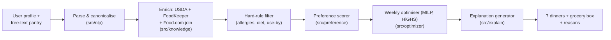
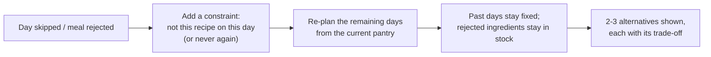

# System flow

How a single planning request moves through the system, and how the plan changes mid-week.

## A planning request

1. **Parse** — the pantry text is structured into quantities, units and canonical ingredients; urgency cues are flagged.
2. **Enrich** — each canonical ingredient picks up its nutrition, shelf-life estimate and candidate recipes.
3. **Filter** — any recipe that would break an allergy, diet, or use-by constraint is removed before anything else runs.
4. **Score** — remaining candidates are scored against the user's stated preferences.
5. **Optimise** — the weekly MILP (solved with HiGHS) picks the 7-day combination that minimises the weighted cost (waste, groceries, nutrition deviation, preference/repetition/time penalties).
6. **Explain** — each chosen meal's reason is read straight off the solver's cost terms and the rules that fired (e.g. "spinach has the shortest remaining shelf life, uses 300g of pantry, fits the nutrition target").
7. **Output** — seven dinners, the grocery box, and the explanations are returned together.

## Mid-week replanning

Two changes are expected mid-week, and both re-solve rather than patch the plan by hand.

**A day is skipped or a meal is rejected**

- Past, already-cooked days are never touched.
- Ingredients from a skipped/rejected meal stay in the pantry and still need to be used — they're prioritised in the re-plan ahead of anything with less shelf life left.
- A rejection is asked "not today, or never?" — "not today" gets a low weight in the preference model, "never" a higher one.
- Anything hitting its use-by date today can't be pushed later; the system suggests freezing it or a same-night quick prep instead.

**Counterfactual question ("what if I don't want paneer?")**

- Add the constraint (or force a recipe into a slot), re-solve, and diff the two plans — which meals changed, and which costs moved (extra groceries, waste).
- Fast enough to be interactive for a 7-day CP problem.
